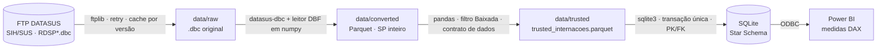
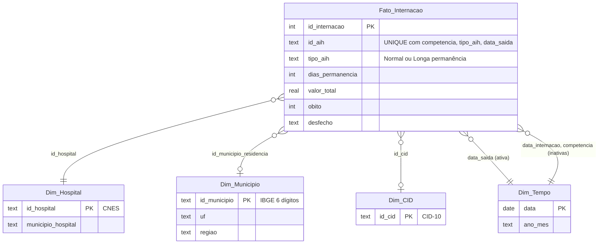

# Painel de Internações SUS — Baixada Santista

[](https://github.com/MatheusCavalcanteF/datasus-etl-baixada-santista/actions/workflows/ci.yml)


Pipeline de dados de ponta a ponta para analisar as internações hospitalares do SUS nos 9 municípios da Baixada Santista (SP). O pipeline:

1. baixa os microdados públicos do SIH/SUS no FTP do DATASUS;
2. converte o formato `.dbc` do governo para Parquet;
3. aplica as regras de negócio do faturamento hospitalar do SUS;
4. entrega um Star Schema no SQLite, consumido por um dashboard no Power BI.

O projeto parte do que os dados mostraram, não do que a documentação promete. Cada regra de negócio abaixo foi verificada nos arquivos reais e validada no próprio pipeline.

## Em números

| | |
|---|---|
| AIHs de SP processadas | **4,69 milhões** (19 competências, jan/2025–jul/2026, 371 MB de `.dbc`) |
| Internações SUS na Baixada | **144.812**, em 24 hospitais, de pacientes de 317 municípios |
| Valor pago pelo SUS | **R$ 244,1 milhões** (tabela SIGTAP) |
| Execução | ~50 s por mês de SP na primeira carga; segundos nas seguintes; transform 1,5 s; load 1,3 s |
| Banco final | SQLite de 27 MB; integridade referencial verificada a cada carga |

Indicadores do período: permanência média de **5,4 dias**, mortalidade hospitalar de **5,44%**, **73,8%** das internações em caráter de urgência e **2,2%** dos pacientes vindos de fora da região.

---

## Arquitetura



| Etapa | Tecnologia | Responsabilidade |
|---|---|---|
| **Extract** (`src/extract.py`) | `ftplib`, `datasus-dbc`, `numpy`, `pyarrow` | Download incremental com novas tentativas; conversão `.dbc` → `.dbf` → Parquet com metadados de origem |
| **Transform** (`src/transform.py`) | `pandas`, `pyarrow` | Recorte geográfico, tipagem, decodificação pelas tabelas oficiais do TabWin, regras de nulos e contrato de dados |
| **Load** (`src/load.py`) | `sqlite3`, `pandas` | Star Schema com PK, FK, CHECK e UNIQUE, carga atômica e conciliação antes do commit |
| **Visualização** | Power BI + DAX | Medidas com regra de negócio do SUS (`powerbi/dax_measures.md`) |

Todas as etapas registram logs no console e em `logs/pipeline.log`, e cada uma pode rodar sozinha.

### Modelo de dados



Decisões de modelagem:
- **Residência × hospital.** O município do *hospital* é atributo da `Dim_Hospital`: cada CNES fica em um único município, o que foi verificado nos dados. Já a `Dim_Municipio` representa a *residência* do paciente e inclui todos os municípios de origem, não só os 9 da região. Assim o Power BI não precisa de duas relações com a mesma dimensão, e nenhuma internação fica sem município.
- **Calendário contínuo em anos completos.** A `data_saida` tem dias sem nenhuma alta. A `Dim_Tempo` cobre esses dias, porque o Power BI exige datas contínuas para marcar a tabela de datas e usar inteligência de tempo.

---

## Desafios de engenharia resolvidos

### 1. Arquivos `.dbc` do governo → Parquet, no Windows e sem compilador C

**Problema.** O DATASUS publica os microdados em `.dbc`, um DBF comprimido num formato próprio. Cada mês de SP tem ~20 MB comprimidos e ~180 MB descomprimidos, com cerca de 250 mil linhas e 114 colunas. O caminho usual, o PySUS, não instala no Windows com Python 3.14 por dois motivos:
- o leitor de `.dbc` dele (`pyreaddbc`) não tem versão pronta para Windows e exige o Visual Studio para compilar;
- o `fastparquet` não tem versão para Python 3.14.

Além disso, os arquivos de estabelecimentos do CNES vêm com o cabeçalho DBF fora do padrão (sem o byte `0x0D` de terminação), e o `dbfread` quebra ao lê-los.

**Solução.**
- A descompressão usa o `datasus-dbc`, que tem versão pronta para Windows.
- A leitura do DBF usa um leitor próprio e vetorizado (`src/dbf_reader.py`). Ele trata o arquivo como uma matriz de bytes de largura fixa e calcula o número de campos pelo tamanho declarado do cabeçalho, sem depender do terminador.
  ```python
  n_records, header_len, record_len = struct.unpack("<IHH", raw[4:12].tobytes())
  records = raw[header_len : header_len + n_records * record_len].reshape(n_records, record_len)
  ```
- **Download incremental:** o DATASUS republica os últimos 12 meses todo mês. O extract compara tamanho e data de modificação (`SIZE`/`MDTM`) do FTP com a cópia local e só baixa o que mudou.
- **Conversão incremental:** cada Parquet guarda nos metadados a versão do `.dbc` de origem, e só é reconvertido se ela mudar.
- **Falhas de rede:** 4 tentativas com espera crescente. Os arquivos são gravados como `.part` e só ganham o nome final depois de conferido o tamanho.
- **Meses que faltam no FTP:** um mês ainda não publicado é tratado como algo normal. Já um mês faltando no meio da série gera alerta.

**Resultado.**
- O leitor é **4x mais rápido que o `dbfread`** lendo todas as colunas (8 s contra 33 s) e **~35x mais rápido** lendo só as colunas usadas.
- A saída foi conferida contra o `dbfread`: as 253.910 linhas × 114 colunas ficaram idênticas.
- Uma nova execução sem novidades no FTP termina em ~3 s.

### 2. Carga idempotente e com integridade referencial

**Problema.** O caminho óbvio, `DataFrame.to_sql(if_exists="replace")`, tem dois defeitos:
- recria as tabelas **sem PK nem FK**;
- grava **tabela a tabela**, de modo que uma falha no meio deixa o banco com dimensões novas e um fato antigo.

E o módulo `sqlite3` do Python, no modo padrão, não inclui `DROP`/`CREATE` na transação.

**Solução.**
- Toda a carga roda numa transação explícita (`BEGIN IMMEDIATE` com `isolation_level=None`): apagar, recriar com o esquema declarado, inserir as dimensões, inserir o fato, validar e só então `COMMIT`.
- O `PRAGMA foreign_keys = ON` faz o próprio banco rejeitar chaves órfãs.
- **Conciliação antes do commit:** contagem de internações, soma de dias e soma de valores do banco são comparadas com o Parquet trusted, e o `PRAGMA foreign_key_check` precisa voltar vazio. Qualquer divergência gera `ROLLBACK`.
- O transform também tem um **contrato de dados** (chave única, colunas obrigatórias, recorte geográfico) e se recusa a gravar a camada trusted se ele for violado.

**Resultado.**
- A carga pode rodar quantas vezes for preciso, sempre com o mesmo resultado.
- Duas falhas propositais, uma FK órfã injetada e uma validação forçada a falhar, deixam o banco exatamente como antes. Esse comportamento é coberto por testes automatizados (`tests/test_load.py`).
- Foi esse contrato que pegou o erro de granularidade descrito no desafio 3.

### 3. Regras de negócio do SUS: maturação dos dados e granularidade da AIH

**Maturação do faturamento.** Os arquivos do SIH são organizados pelo **mês de processamento (competência), não pelo mês da alta**. Medi nos dados quanto tempo as altas levam para chegar:

| Prazo após o mês da alta | Altas já processadas |
|---|---|
| no próprio mês | 87% |
| até 1 mês | 95% |
| até 2 meses | 98,7% |
| até 3 meses | **99,9%** |

Sem tratamento, a variação mês a mês mostraria números falsos nas duas pontas da série:
- **julho/2026 com −7,2%**, só porque parte das altas ainda não foi processada;
- **janeiro/2025 com +570%**, porque dezembro/2024 só contém as altas que chegaram atrasadas.

A solução está na camada semântica: a medida DAX `Status do Mês` classifica cada mês como *Consolidado*, *Preliminar* ou *Incompleto*, a partir da curva de 3 meses e da janela carregada. A variação mês a mês só é calculada entre meses consolidados.

**Granularidade das AIHs de longa permanência.** O número da AIH **não é único**. Uma internação longa gera uma AIH por mês com o mesmo número, cada uma só com os dias e o valor daquele mês. Isso tem três consequências:
- **Contagem:** internações = AIHs do tipo "Normal", que é o mesmo critério do TabNet. Contar linhas inflaria o volume.
- **Permanência média:** a soma dos dias é dividida pelas internações. A média por linha cortaria pela metade a duração das internações longas (11,2 contra 23,5 dias reais nas 167 internações longas do período).
- **Chave:** a primeira versão usava (`id_aih`, `competencia`, `tipo_aih`). Ao ampliar a carga para 2025, o contrato de dados do transform **bloqueou a gravação**: em 2 casos, o hospital tinha apresentado duas fatias mensais na mesma competência. Não eram duplicatas, e sim períodos diferentes, que precisam ser somados. A chave passou a incluir `data_saida`. Antes da correção, verifiquei nos 145.004 registros que a nova chave é única e que nenhuma internação é contada duas vezes.

**Outras regras extraídas dos dados:**
- **AIHs com valor zero:** são 684, todas de leitos de saúde mental pagos fora da AIH. São valores legítimos, que ficam fora do ticket médio.
- **Códigos:** sexo, caráter, tipo de AIH e desfecho foram decodificados pelas tabelas oficiais do TabWin, e não por suposição.
- **Nulos:** a permanência nula é recalculada pelas datas em vez de virar zero, o que derrubaria a média.

---

## Como executar

Requisitos: Python 3.12+ (testado em Python 3.14 no Windows 11; o CI roda os testes em Python 3.12 no Ubuntu) e acesso ao FTP do DATASUS.

```bash
git clone https://github.com/MatheusCavalcanteF/datasus-etl-baixada-santista.git
cd datasus-etl-baixada-santista

python -m venv .venv
.venv\Scripts\activate          # Windows · no Linux/macOS: source .venv/bin/activate
pip install -r requirements.txt

python -m src.extract           # baixa e converte (padrão: ano anterior + ano atual)
python -m src.transform         # recorte da Baixada Santista e regras de negócio
python -m src.load              # Star Schema em data/database/hospital_data.db

pytest tests/                   # 19 testes, ~1 s, sem acesso à rede
```

- Rode sempre a partir da raiz, com `python -m`.
- A primeira extração leva ~50 s por mês de SP. As seguintes só baixam o que o DATASUS republicou.
- Opções do extract: `--inicio AAAA-MM`, `--fim AAAA-MM`, `--uf` e `--forcar` (ignora o cache).
- Meses ainda não publicados são pulados e entram sozinhos na primeira execução depois de publicados.

**Power BI.** Instale o driver ODBC do SQLite (64 bits) e conecte em `data/database/hospital_data.db`. O arquivo `powerbi/dax_measures.md` traz:
- a configuração do modelo (tipos, relacionamentos e tabela de datas);
- as medidas DAX com a explicação de negócio de cada uma;
- uma tabela de valores de referência mês a mês para conferir o relatório.

## Estrutura do repositório

```
├── src/
│   ├── config.py         # caminhos e códigos IBGE da Baixada Santista
│   ├── log_config.py     # logging compartilhado
│   ├── dbf_reader.py     # leitor DBF vetorizado (numpy)
│   ├── extract.py        # FTP → .dbc → Parquet
│   ├── transform.py      # regras de negócio e contrato de dados
│   └── load.py           # Star Schema no SQLite, carga atômica
├── tests/
│   ├── conftest.py       # AIHs sintéticas no layout do DATASUS
│   ├── test_transform.py # chave única, filtro geográfico, dias de permanência
│   └── test_load.py      # média de permanência no banco, idempotência, rollback
├── powerbi/
│   └── dax_measures.md   # medidas DAX, configuração do modelo e valores de referência
├── data/                 # gerado pelo pipeline (fora do git)
├── logs/                 # gerado pelo pipeline (fora do git)
├── pytest.ini
└── requirements.txt
```

## Testes

`pytest tests/` roda 19 testes com AIHs sintéticas no mesmo layout dos arquivos do DATASUS. Os testes executam o transform e o load de verdade, em pastas temporárias, sem dados da rede:

- **Chave única:** fatias de longa permanência na mesma competência são mantidas e somadas; cópias exatas bloqueiam a gravação. Os testes usam os números de AIH reais que motivaram a chave.
- **Filtro geográfico:** só ficam hospitais dos 9 municípios. O filtro é pelo hospital, não pela residência, e rejeita códigos com dígito verificador, truncados ou vazios.
- **Dias de permanência:**
  - a permanência nula é recalculada pelas datas;
  - a alta no mesmo dia vale 0 dias;
  - datas inválidas ou com saída antes da entrada descartam a AIH.
- **Média de permanência no banco:** a fórmula da medida DAX dá 24,25 dias num caso calculado à mão, contra 16,2 dias da média simples por linha. Um recorte sem internações devolve nulo, sem erro.
- **Carga atômica:** a carga é idempotente, e uma falha no meio dela (FK órfã ou validação) mantém o banco anterior.

A suíte também passou por um teste de mutação. Reintroduzi, um de cada vez, três bugs no código: a chave antiga, o filtro pela residência e a permanência nula virando zero. Os testes certos falharam nos três casos.

## Limitações conhecidas e próximos passos

- **Só SUS.** Os leitos não-SUS da região (~43% do total no CNES) não aparecem no SIH.
- **O valor é o pago pela tabela SIGTAP**, não o custo real do hospital.
- **Os últimos 3 meses são preliminares** por natureza do SIH. O painel sinaliza isso em vez de esconder.
- **Taxa de ocupação:** ainda não implementada. Depende dos leitos SUS do CNES e só é possível como estimativa.
- **Nomes de hospitais e descrições de CID:** as fontes estão mapeadas e testadas (API de dados abertos do CNES e tabela CID-10 do DATASUS), mas ainda não foram integradas.
- **Cobertura de testes:** transform e load estão cobertos. O extract (FTP, novas tentativas, cache) e o leitor DBF foram validados manualmente durante o desenvolvimento, mas ainda não têm testes automatizados.

## Fonte dos dados

Ministério da Saúde / DATASUS. Sistema de Informações Hospitalares do SUS (SIH/SUS), arquivos de AIH Reduzida (`RD`), em `ftp.datasus.gov.br/dissemin/publicos/SIHSUS`. Os dados são públicos e anonimizados. A decodificação usa as tabelas auxiliares do TabWin (`TAB_SIH.zip`).

## Autor

[Seu nome] · [LinkedIn] · [GitHub]
